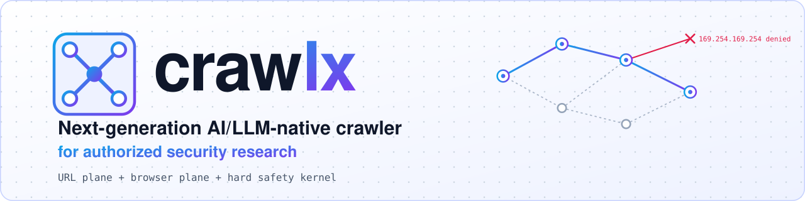
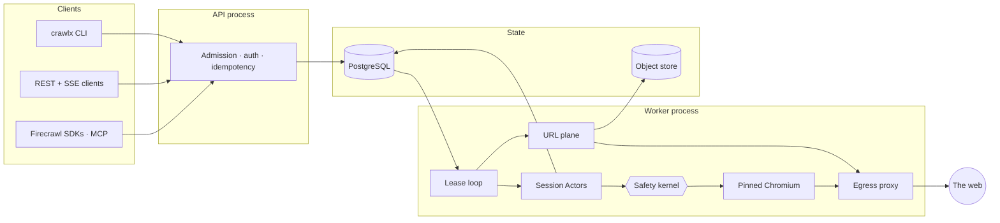
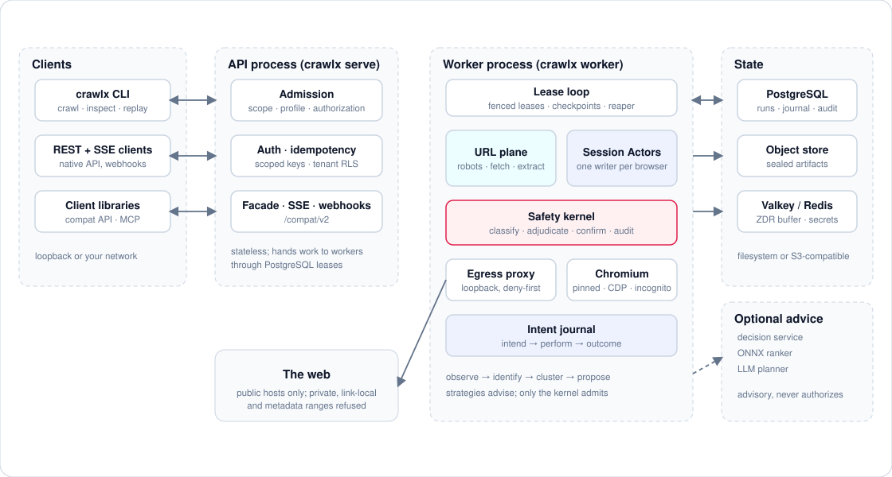

<div align="center">

<picture>
  <source media="(prefers-color-scheme: dark)" srcset="docs/assets/banner-dark.svg">
  
</picture>

**Crawl static sites and dynamic web applications, with a safety kernel that never sleeps.**

[](LICENSE) [](https://github.com/noxred-research/crawlx/actions/workflows/ci.yml) [](https://github.com/noxred-research/crawlx/releases) [](rust-toolchain.toml) [](CONTRIBUTING.md) [](SECURITY.md)

[Why crawlx](#why-crawlx) · [Features](#features) · [Install](#install) · [Quick start](#quick-start) · [Output](#output) · [How it works](#how-it-works) · [CLI](#command-line-overview) · [Responsible use](#responsible-use) · [Security](#security) · [Docs](docs/README.md)

</div>

<p align="center">
  
</p>

<p align="center"><sub>Two real <code>crawlx crawl</code> runs against the bundled CrawlerGym fixture (browser log lines condensed).<br>The second run shows the egress policy refusing the cloud metadata address.</sub></p>

## Why crawlx

Most crawlers are either fast HTTP fetchers that miss everything behind JavaScript, or browser
automations that are slow, fragile and happy to click "Delete account". crawlx runs both planes under
one set of rules.

- **It sees the whole app.** A URL plane for documents and a browser plane for single-page and
  script-heavy applications, in one run (`--mode hybrid`, the default).
- **It is careful by default.** The default profile cannot change server state. An independent safety
  kernel classifies every browser action, and a deny-first egress policy covers every request.
- **It survives crashes.** Every action is journaled before it is performed. After a crash, an
  `unknown` outcome is reconciled by looking at the page, never retried blindly.
- **It is reproducible.** Decisions derive from a seed and recorded paths can be replayed.
- **It fits your stack.** A CLI for one-shot crawls; an API with workers for fleets; a
  Firecrawl-compatible facade and an MCP server for existing clients.

<a id="release-status"></a>

> **Status:** pre-1.0 (0.1.0). Production qualification is in progress. Do not deploy this checkout as a
> public service or use it for sensitive authenticated sessions. The first distribution is this
> repository and tagged source releases; no binaries, images or crates.io packages are published.
> Release-specific limitations are listed in the [changelog](CHANGELOG.md), and open work in the
> [roadmap](docs/roadmap.md).

## Features

| Capability | What you get |
|---|---|
| 🌐 **Static crawling** | Scope (`fqdn`, `rdn`, `dn`, `none`), robots (RFC 9309), sitemaps and feeds, URL canonicalization and shape filters, near-duplicate page filters, conditional requests, bounded bodies and redirects |
| 🧭 **Dynamic crawling** | Chromium over CDP, accessibility-tree discovery, durable element identity, reversible state clustering, a learned enablement graph, seeded and reproducible form input |
| 🛡️ **Safe by default** | `read_only` profile, a hard safety kernel, a deny-first SSRF policy, per-origin politeness, authorization records for anything privileged, an independent safety auditor |
| ♻️ **Crash-safe** | Intent journal with `unknown`-outcome reconciliation, fenced leases, checkpoints, a recovery ladder |
| 📦 **Output** | Markdown pages, `metadata.json`, `links.json`, `report.json`, JSONL, templates, wordlists, bounded WARC/WACZ archives, a REST and SSE API |
| 🔌 **Integrations** | Firecrawl-compatible API facade, MCP server, Katana-style crawl flags, OpenAI-compatible LLM endpoints, optional ONNX ranker and typed-decision service |
| 🔒 **Privacy** | Zero-data-retention mode, secret redaction in logs and exports, encrypted artifact custody, tenant row-level security |
| 🚢 **Operations** | PostgreSQL and S3-compatible storage, Docker Compose, Helm chart, Prometheus metrics, OTLP, alert rules, [runbooks](docs/ops/runbooks.md) |

### Capability highlights

| | `--mode static` | `--mode dynamic` | `--mode hybrid` (default) |
|---|:---:|:---:|:---:|
| Needs Chromium | no | yes | yes |
| Fetches with the HTTP client, writes Markdown pages | yes | no | yes |
| Executes page JavaScript | no | yes | yes |
| Clicks and navigates (`read_only` profile) | no | yes | yes |
| Element identity, state clusters, enablement graph | no | yes | yes |
| Journal and crash reconciliation for actions | n/a | yes | yes |
| Sitemaps, known files, content-similarity filters | yes | n/a | yes |
| Robots enforced | URL fetches | main-frame navigations | both |
| Egress (SSRF) policy | every hop | every browser request | both |

## Install

<details open>
<summary><b>From source</b>: the CLI, development, one-shot crawls</summary>

```
git clone https://github.com/noxred-research/crawlx.git && cd crawlx
cargo build --release -p crawlx-cli          # binary: target/release/crawlx
```

The pinned Rust toolchain (1.97.1, see [`rust-toolchain.toml`](rust-toolchain.toml)) installs through
`rustup`. Dynamic and hybrid crawls also need the pinned Chromium, below.

</details>

<details>
<summary><b>Docker Compose</b>: a single-host stack with PostgreSQL, API, Chromium worker and MinIO</summary>

```
docker/init-compose.sh && docker compose -f docker/docker-compose.yml up -d --build --wait
```

`init-compose.sh` generates the secret files and a bootstrap API key in `docker/.env`. The images are
built locally. `CRAWLX_COMPOSE_UP=1 ci/compose-smoke.sh` checks the stack end to end, and
`crawlx healthcheck --url <URL>` is the probe its containers use.

</details>

<details>
<summary><b>Helm</b>: Kubernetes</summary>

The chart is in [`deploy/helm/crawlx`](deploy/helm/crawlx/Chart.yaml). Build the images from
[`docker/`](docker/), push them to your registry, set `image.registry` and `image.tag`, and create the
Secrets described in [operations](docs/ops/README.md#helm-exact-external-secret-keys) before installing.
Plain manifests, network policies and a safety-auditor CronJob are in [`deploy/k8s`](deploy/k8s/README.md).

</details>

No prebuilt binaries or images are published; build them from a tagged source release.

**Chromium.** Dynamic and hybrid crawls use the pinned Chrome for Testing build in
[`chromium-pin.toml`](chromium-pin.toml). Fetch it with either command; both verify the pinned SHA-256:

```
export CRAWLX_CHROMIUM_PATH=$(ci/fetch-chromium.sh)    # downloads into .cache/chromium/
crawlx browser install                                  # or add --auto-download-chromium to a crawl
```

The launch check reads `CRAWLX_PIN_FILE`, else the nearest `chromium-pin.toml` from the working
directory upward, else the pin embedded in the binary. `CRAWLX_ALLOW_UNPINNED=1` lets a different build
run and records `pinned = false`.

## Quick start

### Static crawl

Crawl a site you are authorized to crawl. It runs in-process with an in-memory store, no database:

```
crawlx crawl https://example.org --mode static --seed 20261019 --limit-urls 50 --output ./out
```

`--seed` makes the run reproducible. Results land in `./out` (see [Output](#output)).

### Dynamic crawl

Observe a web application with the pinned Chromium, without interacting:

```
export CRAWLX_CHROMIUM_PATH=$(ci/fetch-chromium.sh)
crawlx crawl https://app.example.org --mode dynamic --observe-only --output ./out
```

A loopback or private-network target needs an authorization record. For a local fixture, see the
[walkthrough](docs/walkthrough.md#the-authorization-record):

```
crawlx crawl http://127.0.0.1:8080/ --mode dynamic --observe-only \
  --allow-private-networks --authorization-record authz.local.json
```

Drop `--observe-only` to let the default `read_only` profile click and navigate. It still refuses
anything that could change server state.

### API and worker

Start the single-host stack, then create a crawl with the bootstrap API key that `init-compose.sh` wrote
to `docker/.env`:

```
docker/init-compose.sh && docker compose -f docker/docker-compose.yml up -d --build --wait
KEY=$(sed -n 's/^CRAWLX_API_KEY_SPEC="default=\(.*\)"$/\1/p' docker/.env)

curl -s http://127.0.0.1:8080/v1/crawls -H "Authorization: Bearer $KEY" \
  -H 'content-type: application/json' \
  -d '{"seedUrl":"https://example.org/","mode":"static","limits":{"urls":50}}'
# 202 Accepted: {"id":"<run-id>","status":"queued", ...}

curl -s http://127.0.0.1:8080/v1/crawls/<run-id>        -H "Authorization: Bearer $KEY"   # status, counters
curl -s http://127.0.0.1:8080/v1/crawls/<run-id>/pages  -H "Authorization: Bearer $KEY"   # pages
```

The OpenAPI document is served at `/v1/openapi.json`. Without Compose, run `crawlx migrate`,
`crawlx serve` and `crawlx worker` against your own PostgreSQL; see the
[walkthrough](docs/walkthrough.md) and [operations](docs/ops/README.md).

### Firecrawl-compatible clients

The API serves Firecrawl's v2 endpoints under `/compat/firecrawl/v2`. With the stack above, the same key
works there:

```
curl -s http://127.0.0.1:8080/compat/firecrawl/v2/scrape -H "Authorization: Bearer $KEY" \
  -H 'content-type: application/json' \
  -d '{"url":"https://example.org","formats":["markdown","links"]}'
```

The Node and Python SDKs, the `firecrawl` CLI and LangChain's loader are exercised against the facade by
`cargo test -p crawlx-cli --test sdk_python`. To accept `fc-` keys, start the API with
`crawlx serve --firecrawl-keys --api-key acme=fc-<32 hex>`. Base URLs per client, the endpoints each
integration calls and what is not served: [docs/integrations.md](docs/integrations.md).

### MCP

`crawlx mcp` exposes the Firecrawl MCP tools over stdio as a thin client of a crawlx API. The client
configuration is in the [reference](docs/reference.md#mcp-server).

## Output

A CLI crawl prints a short summary and writes files under `--output` (default `./crawlx-out`). This is the
real output of the first run in the demo above:

```
$ crawlx crawl http://127.0.0.1:34635/s1/ --mode static --seed 20261019 \
    --authorization-record authz.local.json --allow-private-networks --limit-urls 50 --output ./out
crawl 01a1b818-be89-7584-953e-8c1b094bf92f mode=static terminal_reason=frontier_exhausted
urls.discovered      90
urls.admitted        30
urls.deduplicated    55
urls.policy_blocked   3
urls.robots_blocked   2
urls.attempted       32
urls.succeeded       30
urls.failed           2
unknown_outcome       0
pages written: 30  -> ./out/pages/*.md  (+ metadata.json, links.json)

out/
├── pages/127-0-0-1-34635-s1-about.md   Markdown of each fetched page, named after its URL
├── metadata.json                       one entry per page
├── links.json                          outgoing links per page
├── report.json                         counters, states, actions; request with header and cookie values redacted
└── artifacts/                          sealed objects; not readable after the process exits (see data and secrets)
```

`metadata.json` (abbreviated; keys are sorted):

```json
[
  {
    "contentType": "text/html; charset=utf-8",
    "fetchedAt": "...",
    "file": "pages/127-0-0-1-34635-s1.md",
    "metadata": { "...": "..." },
    "status": 200,
    "title": "...",
    "url": "http://127.0.0.1:34635/s1/"
  }
]
```

`--jsonl` also writes one record per page to `results.jsonl` (or `-o FILE`). Each record has a
`timestamp`, a `request` (`method`, `endpoint`, `tag`, `attribute`, `source`, ...) and a `response`
(`status_code`, `headers`, `body`, `technologies`, ...). `--list-output-fields` prints every field name,
`--exclude-output-fields` drops some, and `--omit-raw` and `--omit-body` shrink the records:

```json
{"timestamp":"...","request":{"method":"GET","endpoint":"https://example.org/","source":"..."},"response":{"status_code":200,"headers":{"...":"..."},"technologies":[]}}
```

`--output-template '{{url}}'`, `--field` and `--store-field` print or store selected values; see
[wordlists](docs/reference.md#wordlists-and-stored-fields). A dynamic crawl adds recorded states and
actions to `report.json`, and a stored run can be read back with `crawlx inspect` and `crawlx export`.

Native API responses are JSON. `GET /v1/crawls/{id}` returns (abbreviated):

```json
{ "id": "<run-id>", "status": "queued", "terminalReason": null, "mode": "static", "seed": 20261019,
  "safetyProfile": "read_only", "counters": { "urls": { "...": 0 } }, "sessions": [],
  "coverage": { "unit": "ActionContextKey", "discovered": 0, "exercisedTrusted": 0 } }
```

The facade's `POST /compat/firecrawl/v2/scrape` answers `{"success": true, "data": {"markdown": "...", ...}}`.

## How it works



`crawlx crawl` runs the whole pipeline in-process. `crawlx serve` and `crawlx worker` split it: the API
validates and persists a run, and workers lease it from PostgreSQL. Strategies and models only *propose*
actions; the safety kernel alone decides which are admitted, and the Session Actor re-confirms each one
against the live page before performing it.

<details>
<summary>Polished diagram</summary>

<picture>
  <source media="(prefers-color-scheme: dark)" srcset="docs/assets/architecture-dark.svg">
  
</picture>

</details>

Read more: [architecture](docs/design/architecture.md) · [crawl model](docs/design/crawl-model.md) ·
[safety model](docs/design/safety-model.md) · [data and secrets](docs/design/data-and-secrets.md).

## Command-line overview

`crawlx --help` lists the commands. The common ones:

| Command | Purpose |
|---|---|
| `crawl` | Crawl in-process and write files |
| `serve`, `worker`, `migrate` | API (REST, SSE, facade), lease-loop worker, database migrations |
| `inspect`, `export`, `replay`, `replay-response` | Read a stored run, export JSON lines, re-execute a recorded path, replay a retained response offline |
| `extract`, `archive`, `corpus`, `source-import` | Local extraction, WARC/WACZ, operator-authorized local corpus, declarative source manifests |
| `authz` | Authorization records: `create`, `show`, `revoke`, `verify` against an API; `sign`, `challenge` offline |
| `admin`, `config check`, `healthcheck` | Operator commands, configuration validation, container probe |
| `mcp`, `browser` | MCP server over stdio; Chromium tooling |

<details>
<summary>Flags of <code>crawlx crawl</code>, by group</summary>

`crawlx crawl --help` is the full, authoritative list.

| Group | Flags |
|---|---|
| Input | `URL...`, `-u/--url`, `--list FILE`, `-` (stdin), `--request JSON`, `--config FILE`, `--resume FILE`, `-p/--parallelism` |
| Mode and safety | `--mode static\|dynamic\|hybrid` (default hybrid), `--observe-only`, `--profile`, `--authorization-record`, `--allow-private-networks`, `--seed`, `--role` |
| Scope and limits | `--field-scope fqdn\|rdn\|dn\|none`, `--no-scope`, `--crawl-scope`, `--crawl-out-scope`, `--exclude-hosts`, `-d/--depth`, `--strategy`, `--known-files`, `--max-pages-per-host`, `--extension-match`, `--extension-filter`, `--limit-urls`, `--limit-interactions`, `--crawl-duration` |
| Filters | `--filter-similar`, `--content-similar off\|simhash\|tfidf\|bm25`, `--match-regex`, `--filter-regex`, `--match-condition`, `--filter-condition`, `--filter-page-type` |
| Politeness and fetch | `--rate-limit`, `--host-rate-limit`, `--concurrency`, `--delay-ms`, `--timeout`, `--retries`, `--max-response-size`, `--no-redirects`, `--proxy`, `--headers`, `--cookie`, `--user-agent` |
| Extraction | `--js-crawl`, `--javascript-mode off\|regex\|ast\|both`, `--form-extraction`, `--detect-secrets`, `--tech-detect`, `--knowledge-base`, `--custom-field-config` |
| Browser | `--page-load-strategy`, `--dom-wait-time`, `--show-browser`, `--cdp-ws-url`, `--no-incognito`, `--auto-download-chromium`, `--interaction-depth`, `--interaction-max-actions` |
| Output | `--output DIR`, `-j/--jsonl`, `-o/--output-file`, `--output-template`, `--field`, `--store-field`, `--store-response`, `--omit-raw`, `--list-output-fields`, `--silent`, `--verbose` |

Behavior of the less obvious options (source discovery, response cache and replay, adaptive extraction,
Katana-style flags, JavaScript endpoint mining, captcha solving) is in [docs/reference.md](docs/reference.md).

</details>

<details>
<summary>Configuration</summary>

- `crawlx.toml` (path in `CRAWLX_CONFIG`) and `CRAWLX_*` environment variables. `crawlx config check`
  validates them and prints the effective values with secrets redacted.
- Request bodies (API) and `crawlx crawl --request <json>` or `--config <file>` share one request schema;
  command-line flags override the file.
- Pass secrets as `*_FILE` variables or `env://` and `file://` references rather than literal command-line
  values. See [data and secrets](docs/design/data-and-secrets.md#deployment-secrets).
- Safety profile: `read_only` (default), `test_environment`, `authorized_security_test`.
- Retention: `standard`, `extended` and zero-data-retention (ZDR) modes.
- Milestone-gated strategies and model modes need signed gate files; see [`gates/README.md`](gates/README.md).

</details>

<details>
<summary>Repository layout and development</summary>

```
Cargo.toml            workspace (21 crates under crates/)
chromium-pin.toml     pinned Chromium build and CDP revision
ci/                   layering and dependency lint, Chromium fetch/build scripts, gates
bench/                benchmarks, Firecrawl differential harness, Playwright/Patchright oracle
deploy/               Helm chart, Kubernetes manifests, systemd units, alert rules, dashboard
docker/               Dockerfiles, Compose stack, seccomp profile
docs/                 design documentation, integrations, reference, operations
```

```
cargo build --workspace
cargo fmt --all --check
cargo clippy --workspace --all-targets -- -D warnings
cargo test --workspace
ci/lint-deps.sh
```

PostgreSQL tests read `CRAWLX_TEST_DATABASE_URL` and Chromium tests read `CRAWLX_CHROMIUM_PATH`; both skip
when unset. See [CONTRIBUTING.md](CONTRIBUTING.md).

</details>

## Responsible use

Use crawlx only against systems you own or are authorized to test, and respect the policies of the sites
you crawl. You are responsible for your use. By default crawlx:

- honors `robots.txt`; overriding it requires an operator-created authorization record;
- runs the `read_only` profile, which refuses actions that could change server state;
- refuses loopback, private, link-local and cloud-metadata addresses, on every redirect hop and every
  browser request;
- crawls politely: one request in flight per origin, at least 250 ms apart, backing off on `429` and `503`.

Privileged requests (private networks, the `test_environment` and `authorized_security_test` profiles, the
robots override) need an authorization record. The record states what you are authorized to do; it does
not verify that you are. Details: [safety model](docs/design/safety-model.md).

## Security

Report vulnerabilities privately through GitHub private vulnerability reporting, never in a public issue.
[SECURITY.md](SECURITY.md) has the supported versions, response times, safe-harbor terms and scope.

Releases are built from a tag by a gated workflow that publishes a source archive, a CycloneDX SBOM and
`SHA256SUMS` as a draft for a maintainer to publish; verification steps are in
[SECURITY.md](SECURITY.md#verifying-a-release). Workflows run only for code owners, every action is pinned
to a commit, and dependency, secret and static-analysis scans run in CI.

## Getting help

- **Documentation:** [docs/README.md](docs/README.md). Operators: [runbooks](docs/ops/runbooks.md).
- **Bugs and feature requests:** open an issue with the matching form. Include the version or commit and a
  minimal reproduction, and remove credentials and captured third-party content first.
- **Questions:** use the question form after searching the docs and closed issues.
- **Conduct concerns:** [CODE_OF_CONDUCT.md](CODE_OF_CONDUCT.md).

## Contributing

Pull requests are welcome. Read [CONTRIBUTING.md](CONTRIBUTING.md) for the checks, coding standards and
review flow. The [roadmap](docs/roadmap.md) lists open work that is a good place to start.

## Support the project

If crawlx saves you time, a star helps others find it.

[](https://github.com/noxred-research/crawlx/stargazers)

## License

crawlx is licensed under the [GNU AGPL version 3 only](LICENSE) (`AGPL-3.0-only`), not “version 3 or
later.” Third-party dependencies, vendored sources and embedded resources keep their own licenses and
notices: [THIRD_PARTY_NOTICES.md](THIRD_PARTY_NOTICES.md).
