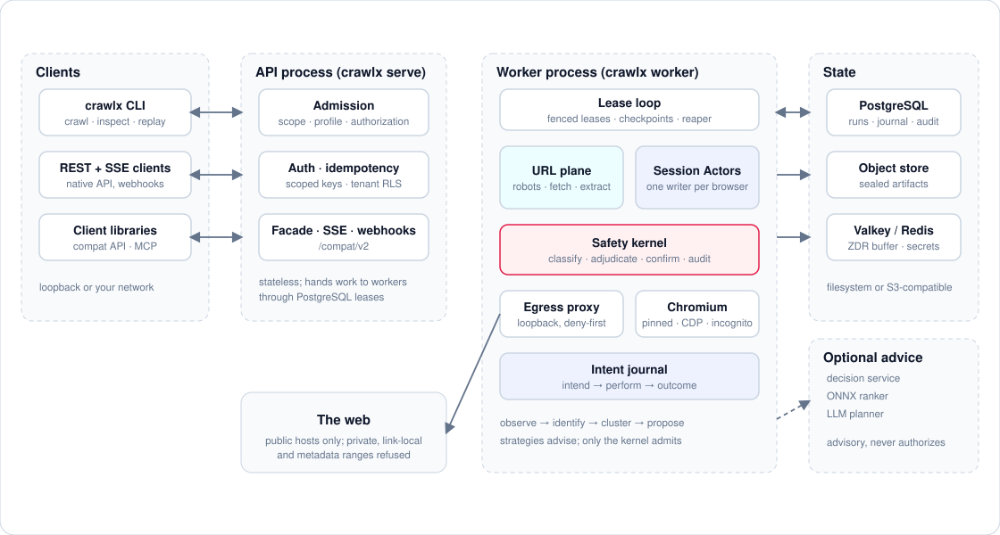

# Architecture

crawlx is a Cargo workspace of 21 crates that implements two cooperating crawl planes behind one API,
one scheduler and one safety boundary. This page describes the crates, the processes they form and
how data moves through them. The [crawl model](crawl-model.md) describes how a dynamic crawl decides
what to do, the [safety model](safety-model.md) what it is allowed to do, and
[data and secrets](data-and-secrets.md) what it keeps.

## Planes

- **URL and content plane.** Static acquisition of documents: scope and robots admission, URL
  canonicalization, a frontier, checked HTTP fetching, content extraction (Markdown, metadata,
  links, structured data) and discovery from sitemaps, feeds and links. It needs no browser.
- **Browser plane.** A pinned Chromium driven over the Chrome DevTools Protocol. It observes
  pages through the accessibility tree, resolves elements to durable identities, clusters page
  states, learns which actions reveal which targets, and performs actions one at a time through a
  single-writer Session Actor.

A crawl may use either plane or both (`--mode static|dynamic|hybrid`). Both planes share the same
admission policy, egress policy, rate limiter, artifact store and retention rules.

## Crates and layering

Allowed dependency edges are enforced by [`ci/layering.toml`](../../ci/layering.toml) and checked by
`ci/lint-deps.sh`. Library crates use `thiserror`; only `crawlx-cli` uses `anyhow`. The whole
workspace forbids `unsafe`.

| Crate | Responsibility |
|---|---|
| `crawlx-core` | Shared IDs, value types, configuration, typed errors and the repository and service traits every other crate implements or consumes. Depends on no other crawlx crate and performs no I/O. |
| `crawlx-url` | Canonicalization, query-parameter classification, sitemaps, link discovery, URL-shape fingerprints, extension and content-similarity filters, the in-memory frontier. Pure and deterministic. |
| `crawlx-policy` | Scope, robots (RFC 9309), egress/SSRF deny tables, admission policy, authorization records and operator attestation, run budgets. Pure logic, no sockets. |
| `crawlx-fetch` | The HTTP fetch plane: DNS behind a trait, per-address egress checks and pinning, per-origin politeness, bounded retries, manual redirects with a re-check per hop, conditional requests, streaming body caps, and the loopback egress proxy used by the browser plane. |
| `crawlx-extract` | HTML to text and Markdown, readability-style content selection, metadata and link extraction, structured-data and secret detection, the process-wide parse-memory budget. |
| `crawlx-browser` | Chromium lifecycle and the CDP adapter behind the `BrowserBackend` and `BrowserContext` traits; the only crate that touches the CDP client library. Pin verification, launch profiles, traffic redaction. |
| `crawlx-observe` | Turns raw browser output into immutable observation bundles; network epochs; quiescence detection. |
| `crawlx-elements` | Candidate discovery, semantic element identity, interactability and action vocabulary. Pure. |
| `crawlx-state` | Volatile-region masks, multi-signal state fingerprints, cluster matching and split-on-contradiction. Pure and deterministic. |
| `crawlx-graph` | The probabilistic enablement graph and path search. Pure and deterministic. |
| `crawlx-forms` | Input classification, deterministic value partitions and form grouping. |
| `crawlx-model` | Typed-decision engines (an HTTP adapter for an external decision service and an optional ONNX ranker), calibration, circuit breaker, rollout gating, the constrained LLM planner DSL, provenance tagging. Cannot authorize an action; does not depend on `crawlx-safety`. |
| `crawlx-safety` | The independent hard safety kernel: classification, profiles, approvals, sinks, audit entries, sealed admitted actions. Depends only on `crawlx-core`, `crawlx-policy` and `crawlx-url`. |
| `crawlx-strategies` | Strategies, frontier, utility function, arbiter and switching policy. Strategies are advisory proposers. |
| `crawlx-storage` | PostgreSQL repositories and migrations, the content-addressed artifact store (filesystem, memory and S3-compatible backends), encrypted custody, retention. |
| `crawlx-scheduler` | Leases, retries, checkpoint cadence, round-robin turns, the stale-lease reaper, monitor schedules. |
| `crawlx-telemetry` | Tracing subscriber with a redaction layer, a metrics registry, span names, optional OTLP export. |
| `crawlx-worker` | The lease loop, browser pool, Session Actors, exploration drivers, the URL-plane runner and the local in-process run. |
| `crawlx-api` | The Axum REST and SSE API, authentication, idempotency, webhooks and the Firecrawl-compatible facade. |
| `crawlx-bench` | CrawlerGym fixture server, replay harness, scorecards, the Firecrawl differential runner, gates and load tools. |
| `crawlx-cli` | The `crawlx` binary: `crawl`, `serve`, `worker`, `migrate`, `inspect`, `replay`, `admin` and the other commands. |

The purity rule matters. `crawlx-url`, `crawlx-elements`, `crawlx-state`, `crawlx-graph`,
`crawlx-strategies` and `crawlx-forms` do not read wall time, do not perform I/O (the observer and
quiescence modules of `crawlx-observe` excepted), and do not iterate hash maps on any path that feeds a
hash or an ordering. Callers pass timestamps in; randomness comes from a seed.

## Processes

<picture>
  <source media="(prefers-color-scheme: dark)" srcset="../assets/architecture-dark.svg">
  
</picture>

- **API process.** Stateless. It validates a request, runs admission, persists the run in `queued`
  status and returns; it serves everything the worker journals, streams SSE from PostgreSQL, sends
  webhooks and hosts the Firecrawl facade under `/compat/firecrawl/v2`. It never touches a browser.
  Without a database URL it keeps runs in memory, where no worker can see them.
- **Worker process.** Runs the lease loop. One lease is either a browser session slot
  `(role, run_index)` or a URL-plane batch. A worker holds at most `worker.max_sessions` leases
  (default 4). Chromium processes start lazily, each hosting at most `worker.contexts_per_browser`
  browser contexts (default 4); every session gets its own incognito context, so cookies and storage
  are never shared between principals.
- **In-process mode.** `crawlx crawl` admits a request through the same admission policy and runs it
  in the foreground with an in-memory store unless `--database-url` is given. It writes
  `pages/*.md`, `metadata.json`, `links.json` and `report.json`.
- **Egress proxy.** Chromium is pointed at a loopback HTTP/CONNECT proxy run by the worker, so
  page-initiated requests face the same egress policy as the HTTP fetcher. See the
  [safety model](safety-model.md#egress-and-ssrf).
- **Optional services.** A typed-decision HTTP service, a local ONNX ranker (cargo feature `onnx`),
  an OpenAI-compatible LLM endpoint, a SearXNG or SearchAPI backend, and a captcha-solver endpoint are
  all opt-in and unreachable unless configured.

## Request lifecycle

1. **Admission.** The API (or the CLI) normalizes the request and runs
   `AdmissionPolicy::admit`: scope, tenant clamps, safety profile, authorization records, gates and
   budgets. A refused request creates no run (`profile_conflict`, `url_denied`, ...).
2. **Persist.** The run is written to PostgreSQL in `queued` status and the API answers with its
   identifier. Idempotency keys make retries safe.
3. **Lease.** Workers claim work with `SELECT ... FOR UPDATE SKIP LOCKED` in `crawlx-scheduler`.
   A lease carries a fencing token; heartbeats extend it using the database clock only.
4. **Execute.** URL-plane batches go through robots, the frontier, the checked fetcher and the
   extractor. Session slots start a Session Actor that drives a browser context.
5. **Journal.** Every state-changing browser action is recorded as intent before it is performed and
   as an outcome after it; observations, transitions, traffic metadata and artifacts are written
   alongside.
6. **Publish.** Content artifacts are stored content-addressed (BLAKE3 keys), sealed under
   custody keys when retained, and referenced from pages. Events feed SSE and webhooks.
7. **Terminate or recover.** A run ends with an explicit terminal reason. A crashed worker's expired
   leases are reaped; its in-flight actions become `unknown` and are reconciled by re-observation
   before they can be retried.

## The Session Actor

The Session Actor owns exactly one `BrowserContext` and is the only code that calls it. It accepts
commands (observe, execute, navigate, checkpoint, restore, reconcile, pause, resume, shutdown) on a
bounded mailbox (32 entries), so a slow browser backpressures the strategies instead of queueing
unbounded work. Its lifecycle states are `Starting`, `Authenticating`, `Ready`, `Acting`, `Recovering`,
`HaltedStorage`, `Paused`, `Closing` and `Failed`. The per-action protocol and the recovery ladder are
described in the [crawl model](crawl-model.md#session-actor-and-intent-journal).

Observation collection runs on the actor, because CDP state is per session. Analysis of an immutable
observation bundle (identity resolution, fingerprinting, diffing, model calls) runs off the actor on
the CPU pool.

## Scheduling

- **Leases.** `lease_next`, `heartbeat`, `release` and `complete` in `crawlx-scheduler` over the
  `LeaseRepo` trait. Defaults: session lease TTL 30 s, URL-batch lease TTL 60 s, heartbeat every 10 s
  (`scheduler.session_lease_ttl_s`, `url_lease_ttl_s`, `heartbeat_s`).
- **Reaper.** Every 15 s it expires stale leases and marks orphaned `intended` actions `unknown`.
- **Round-robin roles.** `roles[] x runsPerRole` expand into run slots. For a shared target the
  barrier enforces run granularity: run `n+1` of any role is not leased until every run `n` is
  terminal. Order is observable and independent of the worker count. With `per_role_replica`, roles
  map to separate application instances and slots run in parallel.
- **Checkpoints.** Cadence: every 50 actions, every 120 s, before risky actions, and on pause,
  approval wait and shutdown.
- **Retries.** Bounded exponential backoff with seeded jitter.
- **Monitors.** Recurring runs with IANA-zone, DST-aware cron schedules (minimum interval 5 minutes).

## Runtime and backpressure

- A multi-threaded Tokio runtime sized from the available parallelism, with a bounded blocking pool.
- A **CPU pool** (a semaphore in front of `spawn_blocking`) takes work that would hold a core for
  long: hashing large bodies, compression, similarity hashing, large snapshot decoding, HTML
  extraction. Its queue depth is a metric.
- Channels are bounded everywhere; the journal path is never write-behind.
- Long-lived tasks are spawned through the worker `Supervisor`, so a panic becomes a typed
  `SessionFailure` tagged with the session instead of a lost task. `panic = "unwind"` is kept in
  release builds for this reason.
- Per-origin politeness and global concurrency are enforced by one `OriginGovernor` shared by both
  planes. See the [safety model](safety-model.md#rate-limits-and-politeness).

## Storage

- **PostgreSQL** is the system of record: runs, sessions, the frontier, pages, actions (the
  journal), states and clusters, enablement edges, safety decisions and approvals, leases, webhooks,
  the audit chain and artifact metadata. Migrations are embedded and forward-only
  (`crawlx migrate`); tenant isolation uses row-level security and a restricted API database role.
- **Artifacts** are content-addressed blobs (BLAKE3 keys) written **before** the transaction that
  references them; a retention sweeper collects orphans, so a failed transaction never leaves a
  dangling reference. Backends: filesystem, memory and S3-compatible.
- **Transactions.** Intent (`proposed -> intended`) commits before any browser mutation. The outcome
  transaction writes the action result, the transition, the traffic batch, any new state and cluster
  membership, ledger and enablement-edge updates and the artifact rows together, so a reader who sees
  `succeeded` sees its transition. A journal failure halts the actor.
- **Derived state.** The frontier of a dynamic run is rebuildable from the coverage ledger and the
  latest observations.

## Telemetry

`crawlx-telemetry` installs a tracing subscriber whose redaction layer rewrites deny-listed field
names and secret-shaped values before any output, a pure-Rust metrics registry (Prometheus text
exposition, optional unauthenticated loopback listener) and a span hierarchy. OTLP export is behind
the `otlp` cargo feature and an explicit collector endpoint. Alert rules and a dashboard live in
`deploy/alerts` and `deploy/dashboards`; the [runbooks](../ops/runbooks.md) map each alert to a
procedure.

## Deployment shapes

- **Single host:** `docker/docker-compose.yml` (PostgreSQL, migrate, API, pinned-Chromium worker,
  MinIO, a volatile Valkey for the secret registry) with opt-in overlays for request identity,
  retained profiles, protocol delegates, delivery and the article-language bundle.
- **Kubernetes:** the Helm chart in `deploy/helm/crawlx` and plain manifests in `deploy/k8s`,
  including network policies, an example nftables network-namespace arrangement and a one-minute safety-auditor CronJob.
- **systemd:** a ZDR cleanup unit and timer in `deploy/systemd`.
- Images: the API image is `distroless` and non-root; the worker image carries the pinned Chromium
  and runs non-root with Chromium's own sandbox (never `--no-sandbox`) and a seccomp profile.

See [operations](../ops/README.md) for provisioning.
