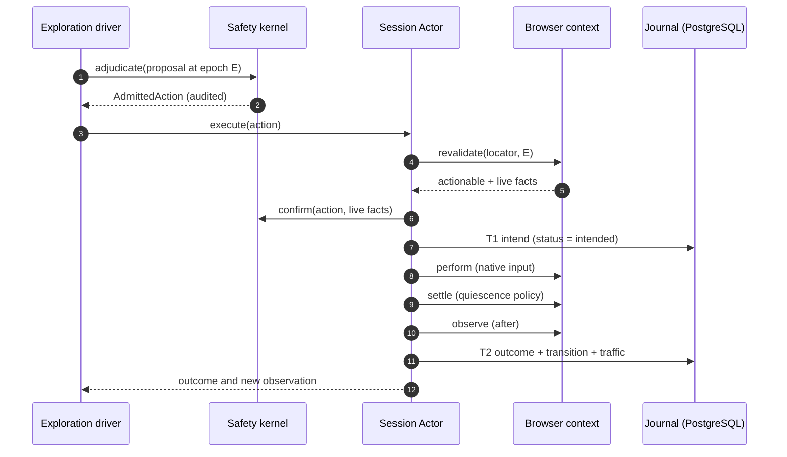

# Crawl model

This page describes how crawlx decides what to fetch and what to do on a page. The
[architecture](architecture.md) page shows where each piece runs; the [safety model](safety-model.md)
shows what limits it.

Two properties hold throughout. **Determinism:** the decision crates read no wall time and no
unseeded randomness, and do not iterate hash maps on paths that feed a hash or an ordering, so a
recorded run can be replayed. **Advisory proposers:** strategies and models propose; only the safety
kernel admits an action, and the Session Actor re-confirms it against live facts.

## URL plane

**Canonicalization.** `Canonicalizer` accepts http and https, lowercases the host, strips userinfo
and a trailing dot, normalizes the path, templates the route (numeric ids, UUIDs, dates and learned
slugs become placeholders), classifies and filters query parameters, and drops the fragment unless
hash routes are enabled. The canonical key is a BLAKE3 digest under a domain tag
(`crawlx/canonical-url/v1`). Trailing slashes are kept, stripped or added (`--trailing-slash`).

**Query-parameter classes.** Every parameter is classified as `RESOURCE_ID` (identifies a
resource: kept, and hashed with a keyed digest where it could be sensitive), `NAVIGATION`,
`FILTER` (the default for unknown parameters), `TRACKING` (dropped), `SESSION` (dropped; values
that repeat across sessions and have high entropy are learned) or `ACTION_BEARING`. The policy is
`classify` (default), `keep_all` or `strip_all`.

**URL-shape fingerprints.** A fingerprint is built from scheme, host, templated path and sorted
query keys. Segments that look like UUIDs, hashes, ObjectIds, hex, dates, timestamps or numbers
become placeholders, and a per-host path trie promotes a position to `{param}` after ten distinct
children. Fingerprints stop the frontier from exploring thousands of `/item/<id>` pages.

**Discovery.** Links from anchors, areas, alternates and canonicals; sitemaps (urlset, index, text;
depth 5, 50,000 URLs); feeds (RSS, Atom, JSON Feed) and robots `Sitemap` lines; known paths. Each
link records its source (`seed`, `sitemap`, `navigation`, `body`, `browser`), and a lower-ranked
source is dequeued first at equal depth.

**Scope.** `ScopePolicy` combines host scope (`fqdn`, `rdn`, `dn`, `none`; `rdn` uses the bundled
public-suffix list), URL include and exclude patterns, host exclusions, extension filters, depth and
per-host page caps. Robots (RFC 9309) is consulted before fetching; see the
[safety model](safety-model.md#robots).

**Frontier.** An in-memory ordered queue (by depth and link-source rank under the chosen strategy) with a
per-origin index and a seen set. Strategies: breadth-first (default), depth-first and priority. Dedupe reasons are
recorded: canonical URL, fingerprint, exact content digest, similar content and extension.

**Similarity filters.** `--content-similar off|simhash|tfidf|bm25` drops pages that are near-duplicates
of ones already admitted (64-bit SimHash over three-word shingles with Hamming distance 3 by default;
TF-IDF and BM25 with a threshold of 0.85), with a per-cluster budget.

**Fetching.** `Fetcher` resolves, checks and pins the address, applies per-origin politeness, follows
redirects manually with a re-check per hop (limit 10), retries `429` and `503` with backoff, sends
conditional requests (ETag, Last-Modified) on the first hop, and caps the decoded body (8 MiB by
default, so a compression bomb stops at the cap). See the
[safety model](safety-model.md#egress-and-ssrf).

**Extraction.** `Extractor::extract` parses once and returns title, description, language, canonical
URL, Markdown, plain text, cleaned HTML of the selected content, metadata and absolute deduplicated
links and assets. Content selection follows `main`/`[role=main]`, a dominant `article`, then
link-density block scoring. Input is bounded (16 MiB, one million nodes, depth 512) and parse memory
is charged to a process budget; see [data and secrets](data-and-secrets.md#parse-memory-budget).

## Browser plane

**Backend.** `crawlx-browser` drives a pinned Chromium over CDP. It is the only crate that depends on
the CDP client library (a lint enforces it), and it spawns Chromium itself in its own process group,
because the client library's launcher sends `Runtime.enable`. `chromium-pin.toml` records the
Chrome for Testing version, CDP revision, download URL and SHA-256. At launch the backend compares the
running version and raises `PinMismatch` unless `CRAWLX_ALLOW_UNPINNED` is set, in which case sessions
record `pinned = false`; replay never silently compares traces across builds.

**Contexts and tabs.** Each session gets its own incognito browser context. Tabs form a bounded graph
(`dynamic.maxTabs`, default 3, at most 8); a popup storm (more than five targets within two seconds)
is refused. Launch flags, proxying and the sandbox are described in the [safety
model](safety-model.md#egress-and-ssrf); Chromium's own sandbox is always on.

**Launch profiles.** `Standard` and `Stealth`. `Stealth` avoids `Runtime.enable` and console capture
and several automation-revealing flags, and is available only under `test_environment` or
`authorized_security_test`; admission rejects it under `read_only`.

**Input and trust lanes.** Actions are performed with native pointer, keyboard and text input. Each
action has a *fidelity* that decides its trust lane: native pointer, keyboard and text input are
`trusted_ui`; file choosers, scripted navigation and scroll, synthetic DOM events and fetch-plane
traffic are `diagnostic`. A synthetic click exists only with `dynamic.syntheticClick = true`.
Only `trusted_ui` outcomes count towards coverage and train the enablement graph.

**Observation.** `crawlx-observe` assembles an immutable `ObservationBundle` from:

- the accessibility tree (`Accessibility.getFullAXTree`), captured on every observation;
- a DOM supplement (attributes, boxes, cursor, event listeners) for escalated nodes only;
- a mutation observer in an isolated world named `crawlx`, which page scripts cannot read or reset;
- network epochs: each action opens one, events are attributed to it, events after settle are `late`
  and low-confidence, service-worker traffic is excluded from trusted attribution, and long-lived
  connections (WebSocket, EventSource, requests pending over 10 s, URLs polled at least three times in
  30 s) do not hold the epoch open;
- optional DOM snapshots (at checkpoints) and screenshots (on novel states).

`ObservationSpec` states exactly which parts to capture, and the bundle records what they cost.

**Quiescence.** `QuiescencePolicy` waits for network idle (default 500 ms), mutation idle (300 ms),
settled navigation and a hard timeout (8 s); it polls every 100 ms. Volatile regions (live regions,
clock-like text, counters, nodes that change without an action) are detected and masked.

## Observation epochs

`ObservationEpoch { navigation_seq, document_seq, mutation_seq }` is assigned at capture. Main-frame
navigation increments the first two, a same-document route change or document replacement increments
`document_seq`, and mutation records increment `mutation_seq`. Every proposal carries the epoch it was
made in.

An action is compatible with the current epoch only if `navigation_seq` and `document_seq` match
exactly and `mutation_seq` has not gone backwards. Idempotent proposals (reveal, navigation, hover)
then proceed to revalidation. Non-idempotent proposals additionally need
`current.mutation_seq - proposal.mutation_seq <= 8`; under `authorized_security_test` and in replay the
slack is 0. An incompatible proposal is dropped (`StaleEpoch`) and the driver re-observes.

`revalidate` is authoritative. It re-checks, on the live page, that the target is attached, visible,
enabled, unobscured, has the same identity and a stable box, and returns `Actionable`, `Detached`,
`IdentityChanged`, `NotVisible`, `Disabled`, `Obscured`, `Unstable` or `StaleEpoch`.

## Element identity

`ElementIdentityV1` is a durable, versioned description of an element: frame lineage, role,
normalized accessible name (digits, dates, relative times and whitespace runs stripped), stable
ancestor role path, container signature, destination key (computed after query-parameter
classification), label signature and control type. Its hash is BLAKE3 over canonical CBOR under the
domain tag `crawlx/element-identity/v1`. A locale-aware V2 schema exists under its own tag; V1 is the
default. When normalization would strip a whole name (`"2024"`), the verbatim name is used so such
controls do not collide.

**Matching.** A newly observed element is matched against known identities. Frame lineage and role are
hard gates (candidates are indexed by them). The remaining evidence is weighted:

| Evidence | Weight |
|---|---|
| Durable attributes (`id`, `name`, `data-testid`, `for`, `aria-controls`, href template) | 0.35 |
| Stable ancestor role path | 0.20 |
| Container signature | 0.15 |
| Control type | 0.15 |
| Accessible-name similarity | 0.10 |
| Geometry overlap | 0.05 |

A score of at least 0.80 reuses the known identity. A score from 0.60 to 0.80 **mints a new identity**
and records the best candidate as an alias; below 0.60 mints new with no alias. Splitting is preferred
because a false split costs redundant exploration while a false merge hides functionality.

**Repeated templates.** Container signatures keep the role only (not the name) for instance containers
such as cards and rows, so every card of a template shares one identity; an `instance_ordinal` (not part
of identity) distinguishes them within an observation. Downstream, `ActionContextKey.resource_context`
tells them apart.

**`RuntimeLocator`.** The handle that lets the actor reach a live node (tab, frame, backend node id,
object id, AX node id, epoch). It is deliberately not `Serialize`: it is never persisted, hashed or
logged, and it dies with its observation.

## State clustering

A `StateSignature` summarizes a page state: route key, a 128-permutation MinHash of the semantic
affordances, a 64-bit SimHash of the DOM structure, a digest of visible element identities, a frame-tree
digest, a network-operation digest, an optional perceptual hash, and an optional digest of storage and
cookie *names* (never values; off by default). Volatile regions are masked first (live regions,
counters, feed items beyond the first 20, nodes found to change without an action).

Matching is two-stage. Stage one is locality-sensitive hashing on the MinHash (32 bands of 4 rows),
restricted to the same route and signature version, SimHash Hamming distance at most 6, at most 16
candidates. Stage two scores 0.45 Jaccard + 0.20 SimHash similarity + 0.15 identity-digest equality +
0.15 route equality + 0.05 frame-digest equality. A score of at least 0.90 attaches; 0.80 to 0.90
attaches and is flagged for review; below that a new cluster is created. A veto requires the set of
consequence-bearing affordances to be identical.

**Split on contradiction.** When, for one action context, the runner-up outcome class (route template,
cluster family, network-operation digest, status class) occurs at least twice and in at least 20 % of
the reliable outcomes, the cluster is split. Outcomes with a settle timeout or late traffic are
excluded.

**Reversibility.** Raw state rows are immutable. Clusters and memberships are derived and versioned: a
split supersedes the source cluster and writes new memberships at `version + 1`. The database allows one
active membership per state. Nothing is rewritten, so a split can be audited or undone by reading the
history.

## Enablement graph

An edge says: in context `C`, action pattern `X` revealed target `T` with probability `p`. Contexts are
an exact state cluster, a route template, or principal-global; lookup goes in that order, and edges never
widen silently. Targets are element identities or clusters.

- **Probability.** Laplace-smoothed `(s + 1) / (s + f + 2)`, where `s` counts support (weak support
  counts half) and `f` failures, multiplied by a decay of `0.5^(age_days / 14)` (14-day half-life).
- **Attribution.** A transition updates the graph only from the trusted lane. A reveal counts only if
  the target was absent from the no-action baseline; WebSocket frames, polling and high volatile-mutation
  ratios (above 0.3) make the credit weak.
- **Generalization.** Exact edges in at least two clusters of one route, with a pooled probability of at
  least 0.8, create a route-template edge keyed by the action family.
- **Retirement.** Edges with three consecutive failures, or at least five trials with `p < 0.2`, are
  pruned; a retired route edge is blocked from regeneration. A build change marks edges unverified.
- **Search.** Dijkstra over edge costs `-ln p + latency + risk + staleness + context penalty`.
- **Calibration** helpers (expected calibration error) exist as library functions; they are exercised by
  tests, not enforced at run time.

## Coverage ledger and action contexts

`ActionContextKey` is (principal, route template, element identity, action kind, input class, resource
context, state cluster); its id is a BLAKE3 digest and its `family_id` omits the cluster. The ledger
classifies each key as `Exercised` (trusted-lane evidence), `DiagnosticOnly`, `NotObservable` (for
example a cross-principal context under `per_role_replica`) or `Uncovered`. A diagnostic execution never
claims coverage. The ledger is rebuilt from the database on restore and updated in the same transaction
as the outcome, so it cannot claim an action the journal does not show.

## Strategies

A `Strategy` is a versioned proposer: `propose(context) -> proposals`. It never touches the browser or
storage and never decides safety. Registered strategies:

| Strategy | Notes |
|---|---|
| `interaction_bfs` (v1) | Default. |
| `event_driven` (v2) | Default. |
| `state_novelty` (v2) | Gated by G1. |
| `enablement` (v2) | Gated by G1. |
| `system1` | Typed-decision ranking over a safe shortlist; modes above `shadow` need G3. |
| `url_plane`, `llm_planner` | Wiring strategies for URL-plane seeding and the constrained LLM planner (`dynamic.llmPlanner`: `off`, `stalled_only`, `enabled`). |

**Round protocol.** The exploration driver ingests the observation, picks a phase, freezes a decision
context (bundle, ledger, graph, frontier at one epoch), runs the enabled strategies concurrently under
deadlines (250 ms deterministic, 1.5 s model-backed; a timeout contributes nothing), and calls the
arbiter.

**Arbiter.** Ordering is deliberate. Proposals are validated (epoch not from the future, right kind,
locator present, right principal), merged by action-context id, and **classified by the safety kernel
before scoring**, so denied and approval-required proposals never compete on utility. Survivors are
scored with a utility function

`U = 1.00·novelty + 0.80·expected_coverage_gain + 0.55·enablement_probability + 0.35·strategy_confidence − 1.50·safety_risk − 0.30·latency_cost − 0.45·repetition_penalty`

and sorted (fresh-key tier first, then utility, then a seeded tie-break, then the key id). The tie-break
is a ChaCha8 draw derived from the crawl seed, the principal and the decision index, so a recorded run
replays identically. The driver then asks the kernel to adjudicate the winner.

**Switching policy.** Phases: `Greedy`, `StateRecovery`, `EnablementRecovery`, `System1`, `Planner`,
`Done`. The policy moves on after configurable stall counts (50 stalled rounds by default, 25 in
recovery, an enablement budget of 500) and enters the typed-decision phase only when it is enabled and
there are at least 12 candidates.

**Typed-decision and ONNX ranker.** `crawlx-model` defines `DecisionEngine`: given a typed question
(choice, score or boolean) over a crawler-built candidate list, it returns calibrated probabilities. Two
engines exist: an HTTP adapter for an external decision service (`DecisionHttpConfig`) and an optional
ONNX ranker (`OnnxRankerEngine`, cargo feature `onnx`, runtime library named by `ORT_DYLIB_PATH`, nothing
downloaded). Raw scores are temperature-scaled; a confidence gate (top probability at least 0.70, margin
at least 0.15) abstains below threshold; a circuit breaker opens after five consecutive or ten of twenty
failures. Page text enters a prompt only inside provenance-tagged `Untrusted` fields, and an LLM plan is a
bounded DSL (at most 20 steps, 16 KiB, candidate indexes and value references only, no selectors or URLs).
`system1Mode` is `off` (default), `shadow`, `advisory` (reorders the safe shortlist) or `active` (may
pick from it).

**Forms.** `crawlx-forms` classifies inputs (email, phone, date, password, OTP, file, ...) from type,
autocomplete, input mode, ARIA role, multilingual labels (English, German, French, Spanish, Turkish)
and pattern; groups them into forms (explicit form, landmark, proximity, orphans); and generates values
from named **partitions** (for example `email:valid_new_user`, `number:out_of_range`, `file:oversized`).
Values are drawn from an RNG derived from the crawl seed, the action context, the partition and the
attempt, with the current date passed in, so they are reproducible. Passwords are returned as secrets.
The default set is the valid baseline only; the expanded set (malformed, boundary, cross-user resource
partitions) requires `authorized_security_test` where it could change state.

## Session Actor and intent journal

The Session Actor is the only code that calls a browser context. For each admitted action it runs:

1. **Epoch check** against the current epoch (drop on `StaleEpoch`).
2. **Revalidate** the target on the live page, then **confirm** with the safety kernel using live facts.
3. **T1 intent:** write the action as `intended` (durable before returning). If this write fails, nothing
   has touched the browser; the actor halts (`HaltedStorage`).
4. **Perform** with native input.
5. **Settle** under the quiescence policy.
6. **Observe** the resulting page.
7. **T2 outcome:** one transaction writes the result, the transition, the traffic batch, any new state and
   cluster membership, ledger and graph updates. T2 is retried (three attempts, 100 ms to 2 s backoff);
   if it still fails the action stays `intended` and the actor halts.



Before step 1 and before any action riskier than a reversible preference, a checkpoint is taken if due.

### Intent journal

`actions.status` follows a state machine enforced both in code and by a database trigger:

```
proposed -> intended -> succeeded | failed | unknown
unknown -> reconciled          succeeded | failed -> reconciled
reconciled -> intended         (retry; only when the resolution was not_applied, attempt + 1)
```

`unknown` means the effect is not known: a crash, lease expiry or lost T2. **`unknown` is not
`failed`.** The lease reaper (every 15 s) flips expired `intended` actions to `unknown`. Before an
`unknown` action can be retried, the reconciler observes the restored session, fingerprints it and
compares with the action's before-state and expected effect:

- `not_applied` (still in the before-cluster, no effect markers): `reconciled`, and the same action id
  may be proposed again once;
- `applied` (after-cluster or effect marker present): `reconciled`, counted with low confidence, never
  retried for non-idempotent kinds;
- `indeterminate`: `reconciled` and treated like `applied` for non-idempotent kinds.

**Recovery ladder.** After a browser crash or CDP disconnect, with two attempts per rung: (1) reattach
if the process is alive; (2) new context plus checkpoint restore (cookies, storage, URL); (3) re-run the
login plan (`builtin:form`) at the checkpoint URL. Exhaustion fails the session with
`recovery_exhausted`. Restore never replays recorded writes.

**Checkpoints.** Every 50 actions, every 120 s (if an action happened since), before risky actions, and on
pause, approval wait and shutdown; the newest three are kept. A checkpoint holds the URL, tabs, cookies,
storage and scroll positions in one sealed artifact (see [data and secrets](data-and-secrets.md)).

**Multi-role runs.** `roles[] x runsPerRole` expand into slots. For a shared target (`targetIsolation:
shared`, the default) the turn barrier is round-robin at run granularity: run `n+1` of any role is not
leased until all runs `n` are terminal, so the order is observable and independent of worker count.
`per_role_replica` maps roles to separate application instances and lifts the barrier; cross-principal
contexts then count as not observable. Each role's frontier, contexts and edges are partitioned by
principal and restored for its next run.

## Gates

Some strategies and model modes are **fail-closed behind signed gate files**, because their authority
depends on evidence that must be earned for the exact build being run.

| Gate | Unlocks | Evidence |
|---|---|---|
| G1 (deterministic traceability) | The `state_novelty` and `enablement` strategies | Scorecards present, no unreconciled `unknown`, no repeated non-idempotent action, chaos suite, identical run-to-run results, at least 99 % trusted-lane actions, recorded paths replayed with at least 95 % match |
| G3 (model authority) | `dynamic.system1Mode` of `advisory` or `active` | At least 10,000 calibration samples, ECE at most 0.05, at least five seeds, a positive coverage-gain interval, zero unauthorized actions, warm p95 under 100 ms |

A gate file (`g1.passed`, `g3.passed`) holds an HMAC-SHA256 attestation over the commit, the build's
**scope digest** (a BLAKE3 hash of every source, config, SQL, data and asset file under `crates/` plus
`Cargo.toml`, `Cargo.lock`, the toolchain file, `chromium-pin.toml` and the layering file, computed by a
build script) and the exact bytes of the companion report. Keys come from `CRAWLX_GATE_KEYS_FILE`; there
is no default key. A missing key, file or report, an unknown key id, a changed report, or a different
scope digest leaves the gate closed.

Defaults need no gate: `dynamic.strategies` is `interaction_bfs` and `event_driven`, and
`dynamic.system1Mode` is `off`. A request that explicitly lists a gated strategy or mode without
authenticated evidence is rejected at admission (CLI, API, and again by the worker) with
`profile_conflict` naming the gate; no run is created. The mechanism is documented for operators in
[`gates/README.md`](../../gates/README.md).
